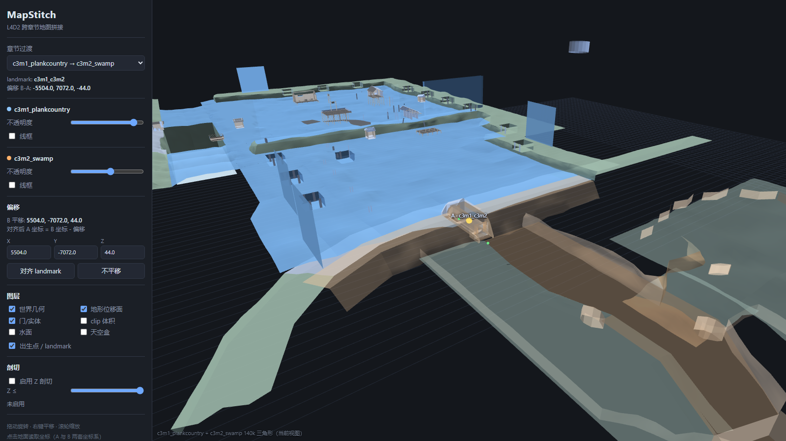

# MapStitch

L4D2 跨章节地图拼接可视化工具。读取相邻两章 BSP，按 `info_landmark` 计算坐标偏移，把两张图叠加到同一个世界坐标里，用来观察"电击器传点"后下一章落点周围有什么。

除世界几何、clip 与门实体外，还会解析 `prop_static`（车辆、货架、家具等）的 MDL
碰撞 hull，以绿色包围盒叠加显示，并参与落点判定。




完整操作说明见 **[使用手册](docs/manual.md)**；实现细节与技术结论见 [调研/实现记录](docs/research.md)；
剩余 180° 旋转与 prop_static 的工作量、验证结论和设计建议见 [剩余需求分析](docs/roadmap.md)。

## 快速开始

日常使用只需要 `start.bat` 和网页，下面两条路任选其一。

**便携包（发给别人 / 不想装 Node.js）**

```powershell
powershell -ExecutionPolicy Bypass -File pack.ps1   # 生成 dist/MapStitch-portable-<日期>.zip
```

把 zip 发出去，对方解压后**双击 `start.bat`** 即可，无需安装 Node、无需联网。

**本机开发（已装 Node 18+）**

```bash
cd MapStitch
npm install      # 仅首次；只装 three.js（可选 lzma-native 用于创意工坊压缩图）
start.bat        # 或 node src/cli.js serve
```

启动后的一切都在页面左侧完成：

- **官方地图**：确认游戏目录（自动检测 Steam，不对可直接改并保存）→ 点「解析官方地图」读取 c1–c14；
- **附加地图 / VPK**：勾选 addon（可多选组合多分卷）→ 点「解析并加入」。

说明：

- `serve` 启动**不会自动解析任何地图**，全部按需生成到 `out/`（可随时删除）；
- 游戏目录不写死：自动从 Steam 注册表与 `libraryfolders.vdf` 查找，页面可改可存，
  命令行可用 `--game-dir <目录>` 或 `L4D2_GAME_DIR`；
- 服务默认只监听 `127.0.0.1`，不暴露到局域网；
- 打包细节见 [使用手册 §11](docs/manual.md)。

## 页面操作

| 区域 / 操作 | 说明 |
|---|---|
| 官方地图 | 显示检测到的游戏目录；可修改并保存；点「解析官方地图」才会读取 57 张官方图 |
| 附加地图 / VPK | 勾选 addon 后「解析并加入」，进度与日志实时显示，完成后自动切换到新章节 |
| 章节过渡 | 官方 43 个相邻章节对 + 已解析 addon 的章节对，切换后自动加载并重算偏移 |
| 拖动左侧分隔条 | 调整面板宽度（双击恢复默认，自动记住） |
| 左键拖动 | 环绕旋转 |
| 中键拖动 | 平移 |
| 右键拖动 | 原地自由视角（只转朝向，不移动相机） |
| 滚轮 | 缩放 |
| `WASD` | 前后左右移动（速度随观察距离缩放） |
| `Q` / `E` | 下降 / 上升 |
| `Shift` / `Ctrl` | 按住加速 ×2.5 / 减速 ×0.4 |
| `F` | 重置视角 |
| 点击表面 | 读取 A / B 两套坐标，并给出 B 落点是否为 clip / solid / prop 包围盒 / 开阔空间 |
| 不透明度 | 分别调 A / B，把另一张图"透视"过去 |
| 线框 | 单图线框模式 |
| 偏移 / 旋转 | B 的旋转角（0/90/180/270°）与平移量；默认按 landmark 自动识别旋转并使 landmark 重合，可手动微调 |
| 图层 | 世界几何 / 地形位移面 / 门实体 / 静态道具包围盒 / clip 体积 / nodraw / 水面 / 天空盒；「静态道具按深度遮挡」默认开启，取消勾选可隔墙看到全部道具 |
| 坐标定位 | 输入 A 坐标放标记，适合把游戏里 `sm_printspawn` 的坐标贴进来 |
| 剖切 | 沿 Z 轴切开：`Z ≤` 上往下切、`Z ≥` 下往上切，可只留一个或同时使用，方便只看某一高度范围 |

左侧"飞行 → 速度"滑块控制基础倍率（默认 ×0.35，设置会记住）。注意浏览器会抢占
`Ctrl+W`（关闭标签页），微调建议直接用滑块。

颜色：**蓝 = 上一章（A）**，**橙 = 下一章（B）**，黄色 = clip 体积，红棕 = nodraw，
绿色 = prop_static 包围盒（默认关闭，在「图层」里打开）。

坐标约定与游戏一致：X 东、Y 北、Z 上。普通换关的 B 几何默认平移 `-offset`，因此 landmark 处两图重合；此时显示的任一点 `p` 满足：

```
B 坐标 = p - B平移量        （默认 B平移量 = -offset，即 B坐标 = p + offset）
```

这与游戏里的换关规则 `下一章坐标 = 上一章坐标 + offset` 一致。

旋转换关（L4D2 的 landmark 名 `coldstream3_coldstream4`，本机 c13m3→c13m4）会按 180° 旋转叠放：B 先绕 Z 轴旋转 yaw，再平移，使 landmark 重合：

```
显示坐标 = lmA + Rz(yaw) · (B 坐标 - lmB)
B 坐标   = lmB + Rz(-yaw) · (A 坐标 - lmA)
```

查看器会自动识别这个 landmark 并设好旋转，也可在「偏移 / 旋转」里手动切 0/90/180/270°。

## 命令行参考

页面上能完成绝大多数操作；以下命令用于脚本化或调试。游戏目录同样支持
`--game-dir <目录>` / `L4D2_GAME_DIR`，地图目录可用 `--maps-dir <dir>`（可重复）。
旋转换关默认按 landmark 名自动识别，`--yaw 0|90|180|270` 可手动覆盖（`pairs` / `build` / `check` 均可用）。

```
node src/cli.js serve [--port 8123] [--host 127.0.0.1]
                                                 启动可视化（不自动解析任何地图）
node src/cli.js build --all [--merge] [--force]  导出全部官方战役（c1–c14，含 DLC 目录）；
                                                 --merge 保留 index 里已有的 addon
node src/cli.js build --campaign c2              只导出某个战役
node src/cli.js build c1m1_hotel c1m2_streets    只导出指定相邻两章
node src/cli.js build --addon <vpk或目录>         解包选中 addon 并合并进 index（可重复 --addon）
node src/cli.js pairs [campaign]                 只算偏移表（秒级，只读实体块；旋转换关会标出角度）
node src/cli.js pairs --addon "Amid The Ruins"   只看选中 addon 的偏移（不解包）
node src/cli.js check c1m1_hotel c1m2_streets 2136 4472 1248
                                                 查一个 A 点传到 B 后落在什么体积里（自动处理旋转换关）
node src/cli.js info c1m1_hotel                  单图 lump / 静态道具 / 统计信息
node src/cli.js addons [filter] [--inspect]      列出 addons / 创意工坊内容
node src/cli.js vpk <file.vpk> [prefix] [--missions]
                                                 列 VPK 目录树，核对 preload/分卷
```

`check` 是最直接的点位筛选工具：给定上一章的坐标，输出下一章坐标以及它是否落在 solid / clip / water brush 内，并给出穿透深度。

```
B 点 = A + 偏移 = (2504.0, 5128.0, 512.0):
  [solid] brush #3506，实体 info_changelevel "c1m1_c1m2_changelevel"，距最近面 64.0
```

## 数据与实现

- `src/bsp.js` — L4D2 BSP v21 读取器（实体、几何、材质、位移、brush、BSP 树）
- `src/gamepath.js` — L4D2 安装目录检测（Steam 注册表 / libraryfolders.vdf / 环境变量 / 页面配置）
- `src/vpk.js` — VPK v1 读取器（跳过 preload、内嵌 `archiveIndex=32767`、分卷 `*_NNN.vpk`）
- `src/addon.js` — addon 发现、missions coop 解析、changelevel 配对、解包缓存
- `src/geometry.js` — BSP → 三角网格；分层（world / disp / sky / nodraw / water / clip / detail）
- `src/props.js` — `prop_static` 包围盒（`prps` GAME_LUMP + MDL studiohdr hull，模型从 VPK/目录查找）
- `src/offset.js` — 相邻章节偏移计算（与 `../tools/l4d2_map_offset.js` 同一算法）+ 官方 DLC 目录合并
- `src/query.js` — 点是否在 brush 体积内（卡墙判定）
- `src/export.js` — `.mst` 二进制格式（JSON 头 + Float32 位置/法线 + Uint8 颜色）
- `src/cli.js` — 命令行入口 + 静态服务器
- `web/` — three.js 查看器（无构建步骤，importmap 直接引用 node_modules）
- `start.bat` / `pack.ps1` — 启动脚本与便携包一键打包

### 关键技术结论（均已逐字节验证）

1. **L4D2 v21 头的 lump 表从 offset 12 开始**，且枚举比 Source 2007 在 26 号之后整体前移 4：
   `DISPINFO=26`、`ORIGINALFACES=27`、`DISP_VERTS=33`、`GAME_LUMP=35`、`PAKFILE=40`、
   `TEXDATA_STRING_DATA=43`、`TEXDATA_STRING_TABLE=44`、`FACES_HDR=58`、`MAP_FLAGS=59`。
   （L4D2 没有 PORTALS/CLUSTERS/PORTALVERTS/CLUSTERPORTALS 四个 lump。）
2. **位移面网格 `(0,0)` 角 = 离 `dispinfo.startPosition` 最近的 face 顶点**。
   快速索引沿 face 顶点顺序的 `base+3`，行索引沿 `base+1`；顶点位置 = 双线性基准 + `vec * dist`。
   用相邻位移面共享边校验：c1/c2/c3/c5 接缝 RMS < 1 单位。
3. **clip 面不在 FACES lump 里**，必须从 `BRUSHES`/`BRUSHSIDES` 的平面重建凸多面体；
   brush 内部 = 对所有侧面满足 `dot(n, p) - d <= 0`。brush→model 归属通过对每个 model 的 BSP 树遍历叶节点得到。
4. brush 实体模型的顶点/平面是**相对实体 origin 的局部坐标**，渲染和点查询都要加回 origin。
5. 材质名在 `TEXDATA` + `TEXDATA_STRING_TABLE/DATA`；`dtexinfo_t` 72 字节，texdata 索引在 +68。
6. 旋转换关由 landmark 名 `coldstream3_coldstream4` 触发（`server.dll` 里的硬编码字符串），
   角度 180°，变换中心是 landmark；不是通用的 `地图A_地图B` 规则。

### 已知限制

- `prop_static` 只显示 MDL 的碰撞 hull 包围盒，不渲染模型网格；个别 addon 依赖未安装的
  模型包时，这部分 prop 会被跳过（`info` / 构建日志里会给出“缺模型”数量）。
  旧版本生成的 addon `.mst` 没有 props 层，重新解析一次 addon 即可。
- 创意工坊图的几何可能 LZMA 压缩，需要 `lzma-native`；`.bsp` 已由 `--addon` 自动解包。
- 默认只加载选中的一个 addon；多分卷 addon 用重复 `--addon` 组合。不会扫描全部 addons。
- addon 无 missions 且 changelevel 不完整时，最终章可能缺失或只能按名称排序兜底。
- 旋转换关只识别 L4D2 已知的 `coldstream3_coldstream4`；其它角度需在页面或命令行
  `--yaw` 手动指定（旧 index 里的 addon 章节对需重新解析才会带上自动识别的角度）。
- 位移面朝向规则在个别重叠/重复 brush 面上会出现"伪相邻"，不影响整体显示。
